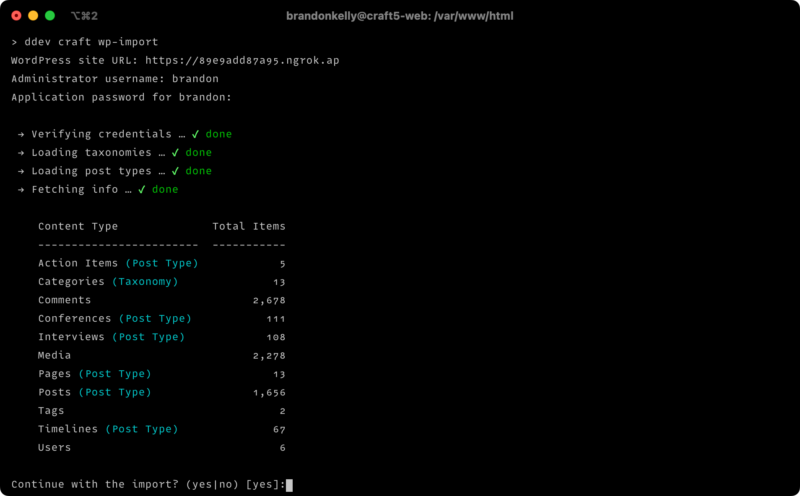

# wp-import

Import all your WordPress content, media, and users into Craft CMS with a single CLI command.



## Table of Contents

- [WordPress Feature Support](#wordpress-feature-support)
- [Requirements](#requirements)
- [Setup](#setup)
- [Usage](#usage)
- [Supported Block Types](#supported-block-types)
- [Supported ACF Fields](#supported-acf-fields)
- [Extending](#extending)
- [Getting Help](#getting-help)

## WordPress Feature Support

Feature | Supported
------- | ---------
Posts | ✅
Pages | ✅
Media | ✅
Categories | ✅ (as entries)
Tags | ✅ (as entries)
Users | ✅
Comments | ❌ (not yet available on Craft 6)
Gutenberg | ✅ (see [Supported Block Types](#supported-block-types))
Custom post types | ✅
Custom taxonomies | ✅ (as entries)
ACF Fields | ✅ (see [Supported ACF Fields](#supported-acf-fields))

## Requirements

Craft 6 and PHP 8.5 are required, as well as the [CKEditor](https://plugins.craftcms.com/ckeditor) plugin.

wp-import 3.x runs natively on Craft 6. For Craft 5, use wp-import 2.x. See [UPGRADE.md](UPGRADE.md) for what changed.

## Setup

### 1. Install the wp-import helper plugin

The import makes use of WordPress’ REST API. The API has *almost* everything we need out of the box, except for a couple things. To fix that, you’ll need to install a simple WordPress plugin that exposes some additional data to authenticated API requests.

To do that, save [plugins/wp-import-helper.php](plugins/wp-import-helper.php) to the `wp-content/plugins/` folder within your WordPress site. Then log into your WP Admin Dashboard and navigate to **Plugins**. Press **Activate** for the “wp-import helper” plugin.

### 2. Create an application password

Within your WP Admin Dashboard, navigate to **Users** and press **Edit** for an administrator’s user account. Scroll down to the “Application Passwords” section, and type “Craft CMS” into the “New Application Password Name” input. Then press **Add New Application Password**.

Write down the username and generated application password somewhere safe. You’ll need it when running the import.

### 3. Include custom post types and taxonomies in the REST API

If you have any custom post types or taxonomies you’d like to be imported, you’ll need to [register them with the REST API](https://developer.wordpress.org/rest-api/extending-the-rest-api/adding-rest-api-support-for-custom-content-types/), by setting `'show_in_rest' => true` in the arguments passed to `register_post_type()`/`register_taxonomy()`.

> [!TIP]
> Post types and taxonomies created with Advanced Custom Fields are included in the REST API by default.

### 4. Include ACF fields in the REST API

If you’re using Advanced Custom Fields, you’ll need to [opt into including your field groups in the REST API](https://www.advancedcustomfields.com/resources/wp-rest-api-integration/#enabling-the-rest-api-for-your-acf-fields) by enabling their “Show in REST API” setting.

Field groups registered via PHP can opt into being included in the REST API by passing `'show_in_rest' => true` to `acf_add_local_field_group()`.

> [!WARNING]
> If you have any Clone fields, edit their settings and ensure that **Display** is set to “Group”. Otherwise their values [won’t get included in the REST API](https://github.com/airesvsg/acf-to-rest-api/issues/93#issuecomment-271560728).

### 5. Install wp-import

First ensure you’re running Craft CMS 6, with the CKEditor plugin installed.

Then run this CLI command:

```sh
> ddev composer require craftcms/wp-import --dev
```

Laravel’s package discovery registers the `wp-import` command.

## Usage

Run this CLI command to initiate the import:

```sh
ddev craft wp-import
```

You’ll be prompted for your WordPress site URL, as well as the username and application password you wrote down earlier.

> [!NOTE]
> If your WordPress site is hosted locally with DDEV, you’ll need to [enable communication between the two projects](https://ddev.readthedocs.io/en/stable/users/usage/faq/#communicate-via-https). From your Craft project, create a `.ddev/docker-compose.communicate.yaml` file with the following contents:
> 
> ```yaml
> services:
>   web:
>     external_links:
>       - "ddev-router:my-wordpress-project.ddev.site"
> ```
> 
> (Replace `my-wordpress-project` with your actual WordPress project name.)
> 
> Then run `ddev restart`.
>
> If the WordPress site resolves to a private IP address, you’ll also need to pass its hostname via the `--allowed-private-hosts` option. (See [Importing from Internal Hosts](#importing-from-internal-hosts).)

The command will then begin importing your content, creating content model components as needed, such as:

- A “Posts” section for your posts.
- A “Pages” section for your pages.
- A “WordPress Content” volume for your media, on the `public` filesystem disk (or the disk passed via `--disk`).
- Structure or Channel sections for your categories, tags, and custom taxonomies, with Entries fields that relate them to posts.
- A “Post Content” CKEditor field with some nested entry types for storing non-HTML block data.

You can import any new content by running the command again later on. Or import just certain posts (etc.) using the `--item-id` option:

```sh
ddev craft wp-import --type=post --item-id=123,789
```

By default, any content that was already imported will be skipped. You can instead force content to be re-imported by passing the `--update` option.

```sh
ddev craft wp-import --type=post --item-id=123 --update
```

To see a full list of available options, run:

```sh
ddev craft wp-import --help
```

### Importing from Internal Hosts

WordPress API URLs, media URLs (and any URLs they redirect to) that resolve to private IP addresses (e.g. `10.0.0.0/8`, `192.168.0.0/16`) are rejected by default. If your WordPress site or its media are hosted on an internal network, for example locally with DDEV, pass their hostnames via the `--allowed-private-hosts` option. Separate multiple hostnames with commas.

Use an exact hostname, or a leading `*.` wildcard to match any subdomain (`*.site.testing.local` matches `api.site.testing.local`, but not `site.testing.local` itself):

```sh
ddev craft wp-import --allowed-private-hosts=my-wordpress-project.ddev.site,*.media.internal
```

Only the private IP range check is relaxed for these hosts. Loopback, link-local and cloud metadata addresses are still rejected.

> [!WARNING]
> Only list hostnames whose DNS you control, and list individual services rather than whole internal domains.

## Supported Block Types

- `core/audio`
- `core/block`
- `core/button`
- `core/buttons`
- `core/code`
- `core/column`
- `core/columns`
- `core/cover`
- `core/details`
- `core/embed`
- `core/gallery`
- `core/group`
- `core/heading`
- `core/html`
- `core/image`
- `core/list-item`
- `core/list`
- `core/more`
- `core/paragraph`
- `core/preformatted`
- `core/pullquote`
- `core/quote`
- `core/separator`
- `core/spacer`
- `core/table`
- `core/video`
- `core-embed/twitter`
- `core-embed/vimeo`
- `core-embed/youtube`
- `cp/codepen-gutenberg-embed-block`
- `dsb/details-summary-block`
- `generateblocks/element`
- `generateblocks/headline`
- `generateblocks/image`
- `generateblocks/media`
- `generateblocks/text`
- `jetpack/slideshow`
- `jetpack/tiled-gallery`
- `videopress/video`

## Supported ACF Fields

- Accordion
- Button Group
- Checkbox
- Clone
- Color Picker
- Date Picker
- Date Time Picker
- Email
- File
- Flexible Content
- Google Map (requires [Google Maps](https://plugins.craftcms.com/google-maps/changelog?craft5) or [Maps](https://plugins.craftcms.com/simplemap))
- Group
- Icon Picker
- Image
- Link
- Message
- Number
- Page Link
- Post Object
- Radio Button
- Range
- Relationship
- Repeater
- Select
- Tab
- Taxonomy
- Text
- Text Area
- Time Picker
- True / False
- URL
- User
- WYSIWYG Editor
- oEmbed

## Extending

There are three types of components that help with importing:

- [Importers](#importers)
- [Block transformers](#block-transformers)
- [ACF adapters](#acf-adapters)

If your WordPress site contains unsupported content types, Gutenberg block types, or ACF field types, you can create your own importers, block transformers, or ACF adapters to fill the gaps.

### Importers

Importers represent the high level types of data that will be imported (posts, pages, users, media, etc.). They identify where their data lives within the WordPress REST API, and populate new Craft elements with incoming data.

Custom importers can be placed within `config/craft/wp-import/importers/`. They must extend `CraftCms\WpImport\Importers\BaseImporter`. See [src/Importers/](./src/Importers) for built-in examples.

### Block Transformers

Block transformers are responsible for converting Gutenberg block data into HTML or a nested entry for the “Post Content” CKEditor field.

Custom block transformers can be placed within `config/craft/wp-import/blocktransformers/`. They must extend `CraftCms\WpImport\BlockTransformers\BaseBlockTransformer`. See [src/BlockTransformers/](./src/BlockTransformers) for built-in examples.

### ACF Adapters

ACF adapters create custom fields that map to ACF fields, and convert incoming field values into a format that the Craft field can understand.

Custom ACF adapters can be placed within `config/craft/wp-import/acfadapters/`. They must extend `CraftCms\WpImport\AcfAdapters\BaseAcfAdapter`. See [src/AcfAdapters/](./src/AcfAdapters) for built-in examples.

### Registering Components With Events

Components that live elsewhere in your project can be registered from a service provider instead:

```php
use CraftCms\WpImport\Events\BlockTransformerTypesResolving;
use Illuminate\Support\Facades\Event;

Event::listen(function (BlockTransformerTypesResolving $event): void {
    $event->types->push(MyBlockTransformer::class);
});
```

`ImporterTypesResolving` and `AcfAdapterTypesResolving` work the same way for importers and ACF adapters.

## Getting Help

If you have any questions or suggestions, you can reach us at [support@craftcms.com](mailto:support@craftcms.com) or [post a GitHub issue](https://github.com/craftcms/wp-import/issues). We’ll do what we can to get you up and running with Craft!
